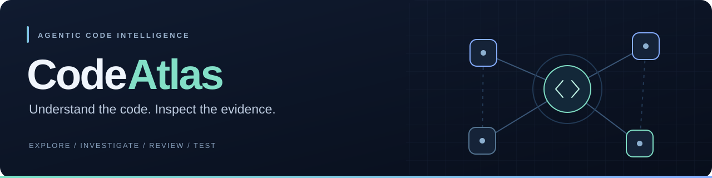

<p align="center">
  
</p>

<p align="center">
  <strong>Explore a codebase. Ask evidence-backed questions. Review changes before they run.</strong>
</p>

<p align="center">
  <a href="https://github.com/miriyala1818/CodeAtlas/actions/workflows/ci.yml"></a>
  
  
</p>

CodeAtlas is a local workspace for exploring public GitHub repositories and preparing changes with clear evidence and explicit execution boundaries. It combines source analysis, dependency views, retrieval, and optional AI assistance in one reviewable workflow.

> **Project status:** MVP for local use. Static analysis is partial; authentication and production multi-user guarantees are not included. Review generated answers and test results before relying on them.

## What you can do

- Import a public repository as a commit-pinned snapshot.
- Explore Python, JavaScript, and TypeScript symbols and dependencies.
- Ask focused questions and trace citations back to source.
- Run bounded agent investigations with visible tool traces.
- Review proposed edits in an isolated draft without changing the imported snapshot.
- Explicitly authorize tests in restricted Docker containers.

**Import → Explore → Ask → Investigate → Review → Test**

Repository source is treated as untrusted input. Import and analysis do not execute it; tests run only after explicit authorization in the configured sandbox.

## Requirements

- Node.js 22.13 or newer and npm
- Python 3.14 for the tested dependency set
- Docker Desktop or Docker Engine with Compose
- A POSIX-compatible shell for the commands below

## Quick start

From the repository root:

```sh
# Create local configuration only if it does not already exist.
cp -n .env.example .env
npm ci
python3.14 -m venv apps/api/.venv
apps/api/.venv/bin/python -m pip install -r apps/api/requirements-dev.lock
apps/api/.venv/bin/python -m pip install --no-deps -e apps/api
```

Start PostgreSQL and apply the database migrations:

```sh
docker compose up -d --wait postgres
apps/api/.venv/bin/alembic -c apps/api/alembic.ini upgrade head
```

In separate terminals, start the API and web application:

```sh
apps/api/.venv/bin/uvicorn codeatlas.main:app --app-dir apps/api --reload --host 127.0.0.1 --port 8000
```

```sh
npm run dev
```

Open [http://127.0.0.1:3000](http://127.0.0.1:3000). The API documentation is available at [http://127.0.0.1:8000/docs](http://127.0.0.1:8000/docs).

## Optional AI features

Repository exploration works without an AI provider key. Local semantic retrieval and Claude-powered reasoning are optional; see the [configuration reference](docs/reference.md) for setup. Keep provider keys in `.env`, which is excluded from Git, and never commit credentials.

## Checks and workflows

Run the frontend checks:

```sh
npm run lint
npm run typecheck
npm test
npm run build
```

Run the API checks from the repository root:

```sh
apps/api/.venv/bin/pytest apps/api/tests -q
apps/api/.venv/bin/ruff check apps/api
apps/api/.venv/bin/ruff format --check apps/api
```

GitHub Actions runs API tests and PostgreSQL migration checks, frontend tests and a production build, and Docker sandbox-boundary tests. Offline evaluations are retained as workflow artifacts. Docker and live-model checks require their optional local setup; see [verification](docs/verification.md) for details.

## Documentation

- [Development and architecture](docs/development.md)
- [Architecture views](docs/architecture-views.md)
- [API, configuration, and sandbox reference](docs/reference.md)
- [Retrieval evaluation](docs/rag-evaluation.md)
- [Repository structure](docs/structure.md)

## License

No license file is included. Public availability does not grant permission to reuse or redistribute this project.
